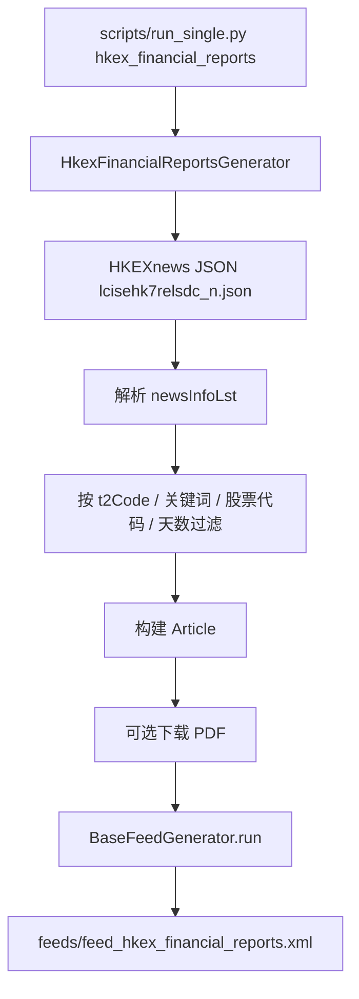

# 引入港股财报 RSS

Feature Name: hkex-financial-reports
Updated: 2026-10-28

## Description

在 `generators/finance/` 下新增港交所披露易财报 RSS 生成器，镜像 `cninfo_announcements.py` 的结构：继承 `BaseFeedGenerator`，用 `requests` 拉取公开 JSON，过滤财报类呈交，映射为 `Article`，可选下载 PDF，输出标准 RSS 2.0。数据源为披露易最新上市公司信息接口，默认只保留年报、中期报告、末期/中期/季度业绩。

## Architecture



与巨潮生成器的关系：两者同属财经模块，共享 `Article` / 去重 / cache / RSS 写出。港股源是 GET JSON 分页，A 股源是 POST form；港股按披露易标题类别代码过滤，A 股按巨潮 `category` / `searchkey` 过滤。

## Components and Interfaces

### 1. `HkexFinancialReportsGenerator`

路径：`generators/finance/hkex_financial_reports.py`

| 项 | 值 |
|---|---|
| `FEED_NAME` | `hkex_financial_reports`（可被 `HKEX_FEED_NAME` 覆盖） |
| `FEED_TITLE` | `披露易 - 港股财报` |
| `FEED_URL` | `https://www.hkexnews.hk/` |
| `FEED_DESCRIPTION` | `港交所披露易上市公司财务报告与业绩公告` |
| `FEED_LANGUAGE` | `zh-HK` |

核心方法：

- `fetch_articles()`：按页 GET JSON，解析、过滤、映射为 `Article` 列表。
- `_fetch_page(page: int)`：请求单页，返回 `(items, max_num_of_file)`。
- `_parse_item(item: dict)`：单条记录转 `Article`；不满足过滤条件时返回 `None`。
- `_match_filters(item)`：t2 / 关键词 / 股票代码 / 天数。
- `_download_pdf(...)`：复用巨潮的文件名清洗与按公司分目录策略。

请求头：

```text
User-Agent: Mozilla/5.0 ...
Referer: https://www1.hkexnews.hk/listedco/listconews/index/lci.html
Accept: application/json
```

URL 模板：

```text
https://www1.hkexnews.hk/ncms/json/eds/lcisehk7relsdc_{n}.json
```

`n` 从 1 起。响应中的 `maxNumOfFile` 表示当前快照的最大页号；第 1 页实测 `maxNumOfFile=5`、每页最多 500 条。页与页之间 sleep `HKEX_REQUEST_INTERVAL`（默认 1.0s）。默认 `HKEX_MAX_PAGES=1`，避免一次拉全量 2000+ 条；需要更多历史时再提高页数。

附件绝对地址：

```text
https://www1.hkexnews.hk{webPath}
```

示例：`https://www1.hkexnews.hk/listedco/listconews/sehk/2026/1028/2026102800024_c.pdf`

### 2. 注册与导出

- `scripts/registry.py` 的 `GENERATORS` 增加 `"hkex_financial_reports": HkexFinancialReportsGenerator`。
- `generators/finance/__init__.py` 导出该类。
- 该生成器走公开 JSON，不加入 `DESKTOP_ONLY_GENERATORS`。

### 3. CLI

`python -m generators.finance.hkex_financial_reports`，参数对齐巨潮：

| 参数 | 环境变量 | 默认 |
|---|---|---|
| `--stocks` | `HKEX_STOCKS` | 空（全市场） |
| `--keywords` | `HKEX_KEYWORDS` | 空 |
| `--t2-codes` | `HKEX_T2_CODES` | 见下方默认代码 |
| `--days` | `HKEX_DAYS` | 7 |
| `--max` | `HKEX_MAX_ITEMS` | 50 |
| `--download-pdf` | `HKEX_DOWNLOAD_PDF` | false |
| `--full` | — | 忽略 cache |

### 4. CI

新增 `.github/workflows/generate_hkex_financial_reports.yml`，结构复制 `generate_feeds.yml`：

- cron：`0 */6 * * *`
- `HKEX_DOWNLOAD_PDF=false`
- `HKEX_MAX_ITEMS=30`
- `HKEX_MAX_PAGES=1`
- 运行 `python scripts/run_single.py hkex_financial_reports`
- 校验并提交 `feeds/feed_hkex_financial_reports.xml`

### 5. 文档

更新 `generators/finance/README.md` 与根 `README.md` 的信息源表，补充港股财报订阅说明。

## Data Models

### HKEXnews JSON（实测 2026-10-28）

顶层：

```json
{
  "genDate": "1793156162801",
  "maxNumOfFile": 5,
  "newsInfoLst": [ ]
}
```

`newsInfoLst[]`：

| 字段 | 类型 | 含义 |
|---|---|---|
| `newsId` | int | 呈交唯一 ID |
| `title` | str | 文件标题 |
| `lTxt` / `sTxt` | str | 一二级标题中文描述，如 `公告及通告 - [季度業績]` |
| `ext` | str | `pdf` 或 `htm` |
| `size` | str | 如 `334KB` |
| `webPath` | str | 站点相对路径 |
| `market` | str | `SEHK` |
| `stock` | list | `[{ "sc": "00700", "sn": "騰訊控股" }]`，可多只 |
| `relTime` | str | `28/10/2026 06:33`（香港时间） |
| `t1Code` | str | 一级标题代码 |
| `t2Code` | str | 二级标题代码，多个时逗号拼接 |
| `multi` | int | 是否多文件 |
| `dod` / `dodPath` | str | 收购守则展示文件标记 |

### 默认财报二级代码

完整码表、URL 拼法、搜索 POST/GET 参数见同目录 `hkexnews-search-filter.md`。码表来源是披露易标题搜索页加载的官方 JSON，不是从 `lTxt` 反推：

- 一级：`https://www1.hkexnews.hk/ncms/script/eds/tierone_c.json`
- 二级：`https://www1.hkexnews.hk/ncms/script/eds/tiertwo_c.json`
- 二级分组：`https://www1.hkexnews.hk/ncms/script/eds/tiertwogrp_c.json`

`titlesearch/config_c.js` 声明上述 URL；`titlesearch.js` 用它们填充「标题类别」下拉框，提交时写入表单字段 `t1code` / `t2code` / `t2Gcode`。最新呈交 JSON 里的 `t1Code` / `t2Code` 与这套码一致。

默认 Feed 使用的 5 个二级码（均在 `tiertwo_c.json` 中，名称与 count 为 2026-10-28 取值）：

| t1Code | t2Code | 官方名称 | 搜索页 count |
|---|---|---|---|
| 40000 | 40100 | 年报 | 63 |
| 40000 | 40200 | 中期/半年度报告 | 432 |
| 10000 | 13300 | 末期业绩 | 121 |
| 10000 | 13400 | 中期业绩 | 20 |
| 10000 | 13600 | 季度业绩 | 80 |

匹配规则：将条目 `t2Code` 按逗号拆分后，与目标集合求交非空即命中（一条呈交可挂多个二级标题）。

明确排除：

| t2Code | 官方名称 | 排除原因 |
|---|---|---|
| 40300 | 季度报告 | 整本季度报告；当前 count=0，港股季报通常发在 `13600` |
| 40400 | 环境、社会及管治资料/报告 | ESG，不是财务报表 |
| 13650 | 附属公司的业绩 | 子公司业绩 |
| 13500 | 盈利警告 | 预告，不是已刊发业绩 |
| 13700 / 13800 | 修订已刊发初步业绩 / 修改已刊发的财务报表及报告 | 更正件，可用 `HKEX_T2_CODES` 按需打开 |

实现注意：`13300` 也会打在「年报补充公告」这类后续文件上。这是发行人自选标题类别的结果，过滤器按代码收录，不靠标题正则二次清洗。

过滤优先级：若设置了 `HKEX_T2_CODES`，用该列表替换默认集合；`HKEX_KEYWORDS` 与 `HKEX_STOCKS` 在类别过滤之后叠加，均为「保留命中项」。

### Article 映射

| Article 字段 | 来源 |
|---|---|
| `url` | `https://www1.hkexnews.hk` + `webPath` |
| `title` | `[sn] title`，多股票 `sn` 用顿号连接 |
| `published_at` | `relTime` 按 `Asia/Hong_Kong` 解析后转 UTC |
| `summary` | `title` 截断 200 字 |
| `content` | HTML：标题、代码、简称、`lTxt`、时间、ext/size、原文链接、可选本地路径 |
| `category` | `港股财报` |
| `author` | `HKEXnews` |

去重键沿用基类：`Article.url`（即附件 URL）。`webPath` 为空时回退为 `https://www.hkexnews.hk/#newsId={newsId}`，保证每条仍有稳定 URL。

时间解析失败时使用当前 UTC 时间，并打 warning 日志。

## Correctness Properties

- 默认过滤集只覆盖财报/业绩类 t2 代码；全量最新呈交（停牌、通函、翌日披露）不会进入默认 Feed。
- 同一附件 URL 在 cache / SQLite / 本次结果中只出现一次。
- `HKEX_MAX_ITEMS` 限制最终写入 Feed 的条数；分页在收集到该上限后停止。
- `HKEX_DAYS` 以香港日历日比较，避免把 UTC 日期边界当成过滤日。
- PDF 文件名去掉 Windows/POSIX 非法字符，单段标题最长 50 字符，与巨潮 `_safe()` 行为一致。
- 请求间隔 >= 配置值；失败页中断后续翻页，已解析条目仍交给基类合并。

## Error Handling

| 场景 | 处理 |
|---|---|
| HTTP 非 200 / 超时 | 记录错误，停止翻页；已有条目继续生成；若本次 0 条则走基类「保留旧 Feed」逻辑 |
| JSON 解析失败 | 同请求失败 |
| 单条字段缺失 | 跳过该条并记 warning |
| `relTime` 无法解析 | 使用当前 UTC，条目仍保留 |
| PDF 下载失败 | 条目仍写入 RSS，正文只保留远程链接 |
| 空 `newsInfoLst` | 视为该页结束，停止翻页 |

不对该公开 JSON 做浏览器渲染或登录。

## Test Strategy

1. **JSON 解析单元测试**：用截取的 2～3 条真实 `newsInfoLst` fixture（含多股票、多 t2Code、htm 附件、缺 `webPath`）验证映射字段。
2. **过滤测试**：默认代码集命中年报/季度业绩，排除停牌（t2=`17960`）与翌日披露（t1=`50000`）；`HKEX_STOCKS=700` 命中 `00700`；关键词「季度」过滤标题。
3. **时间测试**：`28/10/2026 06:33` 解析为香港时间后转 UTC（`2026-10-27T22:33:00+00:00`）。
4. **分页测试**：mock 第 1 页 `maxNumOfFile=2` 且满页、第 2 页不足一页，断言请求次数与合并条数。
5. **手工冒烟**：`python scripts/run_single.py hkex_financial_reports --max 10`，检查 `feeds/feed_hkex_financial_reports.xml` 可用 `scripts/validate_feeds.py` 通过。

## References

[^1]: (Website) - [HKEXnews 最新上市公司信息 JSON 第 1 页](https://www1.hkexnews.hk/ncms/json/eds/lcisehk7relsdc_1.json)
[^2]: (Website) - [HKEXnews 最新上市公司信息页面](https://www1.hkexnews.hk/listedco/listconews/index/lci.html)
[^3]: (Website) - [标题搜索页配置，声明 tierone/tiertwo JSON 路径](https://www1.hkexnews.hk/ncms/eds/titlesearch/config_c.js)
[^4]: (Website) - [官方一级标题类别](https://www1.hkexnews.hk/ncms/script/eds/tierone_c.json)
[^5]: (Website) - [官方二级标题类别](https://www1.hkexnews.hk/ncms/script/eds/tiertwo_c.json)
[^6]: (Filename) - [巨潮公告 RSS 生成器](generators/finance/cninfo_announcements.py)
[^7]: (Filename) - [生成器基类 Article 与 run 流程](generators/base.py)
[^8]: (Filename) - [生成器注册表](scripts/registry.py)
[^9]: (Filename) - [巨潮年报 GitHub Actions](.github/workflows/generate_feeds.yml)
